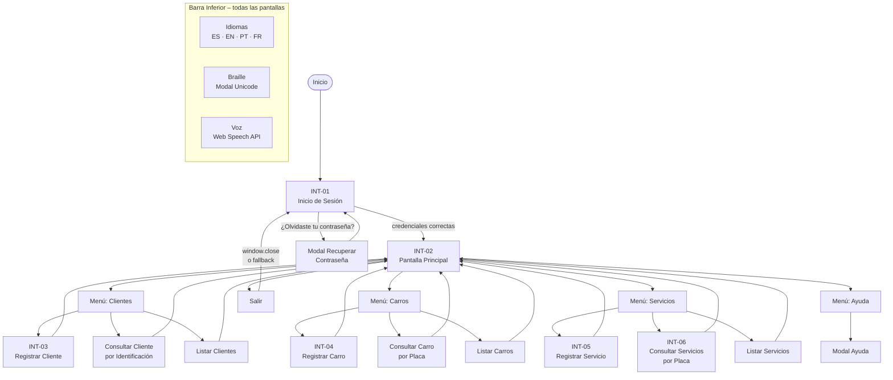

# Serviteca ADSO
**Sistema de Gestión Automotriz** · Evidencia: Maquetación e Interfaz Gráfica de Usuario  
Programa ADSO – SENA

---

## Credenciales de prueba

| Campo | Valor |
|-------|-------|
| Usuario | `admin` |
| Contraseña | `1234` |

> Definidos como constantes en `src/views/LoginView.tsx` (líneas `VALID_USER` / `VALID_PASS`).

---

## Requisitos previos

- [Node.js 18+](https://nodejs.org/) (incluye npm)

---

## Instrucciones para ejecutar

```bash
# 1. Instalar dependencias
npm install

# 2. Iniciar servidor de desarrollo
npm run dev
```

Abrir en el navegador: `http://localhost:5173`

```bash
# Generar build de producción
npm run build

# Vista previa del build
npm run preview
```

---

## Estructura del proyecto

```
Serviteca 2.0/
├── index.html
├── package.json
├── vite.config.ts
├── tsconfig.json
├── README.md
├── CHECKLIST_REQUERIMIENTOS.md
├── .kiro/
│   └── specs/serviteca-adso/
│       ├── requirements.md
│       ├── design.md
│       └── tasks.md
└── src/
    ├── main.tsx                  ← Punto de entrada
    ├── App.tsx                   ← Raíz; gestiona autenticación
    ├── styles/
    │   └── theme.css             ← Variables CSS (colores, fuente)
    ├── types/
    │   └── index.ts              ← Interfaces Cliente, Carro, Servicio; Screen, Lang
    ├── context/
    │   └── I18nContext.tsx       ← Contexto de idioma; hook useI18n
    ├── i18n/
    │   ├── es.ts                 ← Diccionario español
    │   ├── en.ts                 ← Diccionario inglés
    │   ├── pt.ts                 ← Diccionario portugués
    │   ├── fr.ts                 ← Diccionario francés
    │   └── index.ts              ← Mapa de diccionarios y códigos BCP-47
    ├── utils/
    │   ├── storage.ts            ← CRUD localStorage (clientes, carros, servicios, sesión)
    │   ├── braille.ts            ← Conversor texto → Braille Unicode Grade 1
    │   └── speech.ts             ← Web Speech API (speak / stopSpeech)
    ├── components/
    │   ├── Logo.tsx              ← SVG llave + título centrado
    │   ├── Modal.tsx             ← Overlay modal reutilizable
    │   ├── FormCard.tsx          ← Tarjeta 600×500 px con pie de botones
    │   ├── DataTable.tsx         ← Tabla genérica encabezado caoba
    │   ├── MenuBar.tsx           ← Barra superior verde con submenús (INT-02)
    │   └── BottomMenu.tsx        ← Barra inferior: Idiomas, Braille, Voz (INT-07)
    └── views/
        ├── LoginView.tsx         ← INT-01
        ├── MainView.tsx          ← INT-02 contenedor
        ├── ClientForm.tsx        ← INT-03
        ├── CarForm.tsx           ← INT-04
        ├── ServiceForm.tsx       ← INT-05
        ├── ServiceQueryView.tsx  ← INT-06
        ├── ClientQuery.tsx       ← Clientes → Consultar
        ├── CarQuery.tsx          ← Carros → Consultar
        ├── ClientList.tsx        ← Clientes → Listar
        ├── CarList.tsx           ← Carros → Listar
        └── ServiceList.tsx       ← Servicios → Listar
```

---

## Mapa de sitio y flujo de navegación



---

## Paleta de colores y tipografía

| Token CSS | Valor | Uso |
|-----------|-------|-----|
| `--color-primary` | `#2E7D32` | Menús, botones principales |
| `--color-secondary` | `#8B3A1E` | Bordes, encabezados de tabla, títulos de formulario |
| `--color-bg` | `#F0F0F0` | Fondo general |
| `--color-white` | `#FFFFFF` | Texto sobre verde/caoba |
| `--color-text` | `#212121` | Texto principal |
| `--font-main` | `'Times New Roman', Times, serif` | Toda la interfaz |

---

## Servicios disponibles

| Código | Servicio |
|--------|---------|
| 1 | Cambio de aceite |
| 2 | Sincronización |
| 3 | Alineación |
| 4 | Lavado |

---

## Notas técnicas

- **Sin backend**: todos los datos persisten en `localStorage` bajo las claves `sva_clientes`, `sva_carros`, `sva_servicios`.
- **Sin react-router**: la navegación es por estado (`Screen` en `App.tsx` / `MainView.tsx`).
- **i18n local**: 4 idiomas sin dependencias externas; cambio en tiempo real vía `I18nContext`.
- **Braille Grade 1**: conversor local en `utils/braille.ts`; cubre a–z, A–Z, 0–9 y puntuación básica.
- **Accesibilidad de voz**: `Web Speech API` nativa del navegador; sin claves de API.
